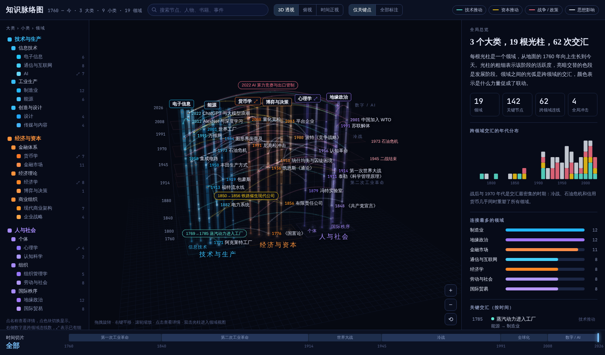

# knowledge-atlas · 知识脉络图

一张可交互的 3D 跨领域知识地图，时间范围从 1760 年至今。它把设计、制造、电子信息、AI、货币、经济、心理、组织、地缘等领域的发展脉络放进同一个空间里，用来建立全局认识，作为继续学习的脚手架。

- **全局视图**：每个领域是一根光柱，柱上标出发展阶段和关键节点。领域之间用光弧相连，每条弧都说明“具体发生了什么，才促成两个领域联动”。
- **领域视图**：把一根光柱展开成五条泳道，分别是里程碑、经典著作、人物、思想、辩论。其他领域只显示为可以点击跳转的出口，不展开内容。



## 目录

```
docs/
  requirements.md   原始需求、访谈记录、用户反馈、待办
  design.md         当前实现的设计说明和已知问题
  data-schema.md    数据结构
  assets/           线框图和截图
src/
  index.html        页面，按 claude.ai Artifact 格式编写，没有 <html>/<head>/<body> 外壳
  data.js           全局视图数据：领域、节点、连线
  detail.js         领域视图细节：著作、人物、思想、辩论
tools/
  screenshot.js     本地截图检查，用 Playwright 驱动
  gen_wireframe.py  生成最初的 SVG 线框图
```

## 本地运行

`src/index.html` 是 Artifact 页面片段。在浏览器里直接打开也能运行，浏览器会自动补上外壳。

页面依赖 CDN 上的 Three.js r128 和 OrbitControls。如果网络无法访问 CDN，先把这两个文件下载到 `tools/vendor/`，`tools/screenshot.js` 会读取这里的本地副本：

```bash
cd tools && npm pack three@0.128.0 && tar xzf three-0.128.0.tgz && mkdir -p vendor && cp package/build/three.min.js package/examples/js/controls/OrbitControls.js vendor/ && rm -rf package three-0.128.0.tgz
```

截图命令的参数依次是：宽、高、输出文件，以及可选的一段在页面里执行的 JS（只能操作 DOM，页面内部函数不是全局的）。

```bash
node tools/screenshot.js 1440 900 out.local.png
```

## 状态

- 全局视图：3 个大类、9 个小类、19 个领域，142 个节点、62 条连线。
- 领域细节：已完成 AI、经济学、货币学、心理学。其余 15 个领域待补。

更多计划见 [docs/requirements.md](docs/requirements.md#5-当前状态与待办)。
